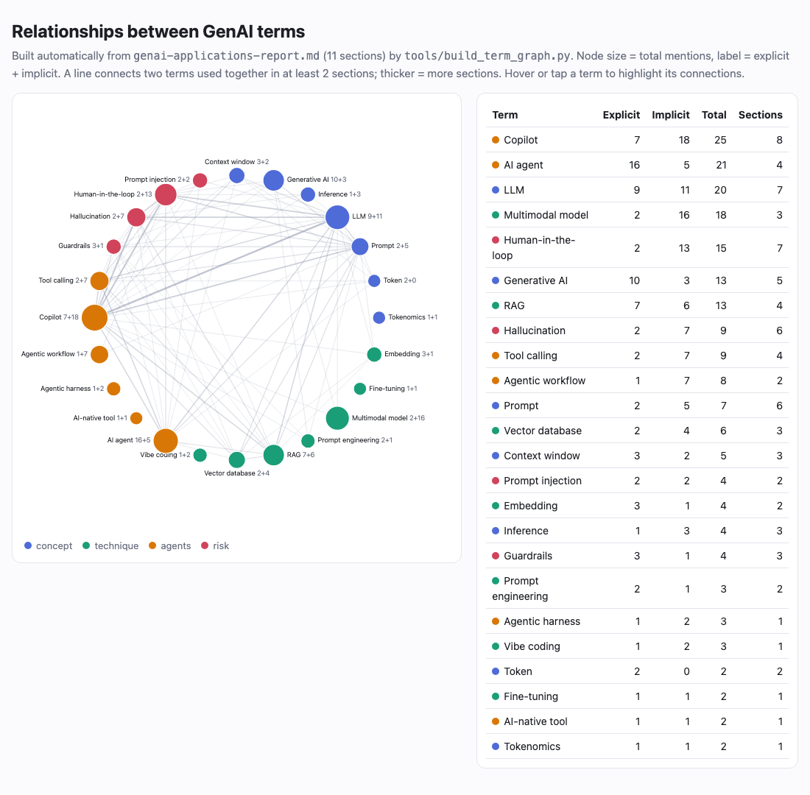

# Course Introduction: GenAI Applications Research

Practical assignment of the Course Introduction module.

| File | Content |
|---|---|
| [`genai-applications-report.md`](genai-applications-report.md) | **Report** on 8 GenAI use cases: business value, technical challenges, weaknesses and real products (name, link, description) for each |
| [`glossary.md`](glossary.md) | **Glossary**: 24 GenAI terms from the report, explained in my own words with personal examples |
| [`term-graph.png`](term-graph.png) · [`term-graph.html`](term-graph.html) | **Term relationship graph** (optional task): how often each term is used in the report, explicitly and implicitly, and which terms appear together |
| [`term-mentions.md`](term-mentions.md) | The same counts as a table |
| [`tools/build_term_graph.py`](tools/build_term_graph.py) | Script that builds the graph and the table from the report automatically |

## Term relationship graph



- **Explicit mention**: the term or its abbreviation is written in the text (*"RAG"*, *"LLM"*).
- **Implicit mention**: the idea is used without naming the term
  (*"the bot invents a policy that does not exist"* → Hallucination, *"a person reviews the result"* → Human-in-the-loop).
  Explicit matches are masked first, so one phrase is never counted twice.
- Two terms are connected when they are used in the same section of the report (at least 2 sections);
  a thicker line means more shared sections.

The interactive version is `term-graph.html`: download it and open it in a browser, then hover over a term
to highlight its connections.

## How it was made

The assignment was completed with an **agentic workflow**, as suggested in the acceptance criteria:

1. I gave the task description to an AI coding agent working in my terminal (an agentic harness with
   access to files, git and the browser).
2. The agent researched the use cases, wrote both `.md` files, checked that every link in the report
   opens, and created the `course-introduction` folder in this repository.
3. For the optional subtask the agent wrote `tools/build_term_graph.py`: it counts explicit and implicit
   mentions of every glossary term, finds which terms are used together, and renders `term-graph.html`;
   the PNG is a screenshot of that page made with headless Chrome.
4. The agent committed and pushed the result, checking first that no secrets or irrelevant files
   get into the repository.
5. I reviewed the report and the graph and asked for changes (for example, adding terms from the
   course introduction: AI-native tool, agentic harness, vibe coding, tokenomics, and describing every
   use case in two paragraphs).
6. **The glossary I wrote myself**: I selected the terms from the report and explained each of them in
   my own words with my own examples; the agent only formatted the file and added the table of contents.

## Rebuild

```bash
python3 tools/build_term_graph.py
```

Python 3.9+, standard library only.
